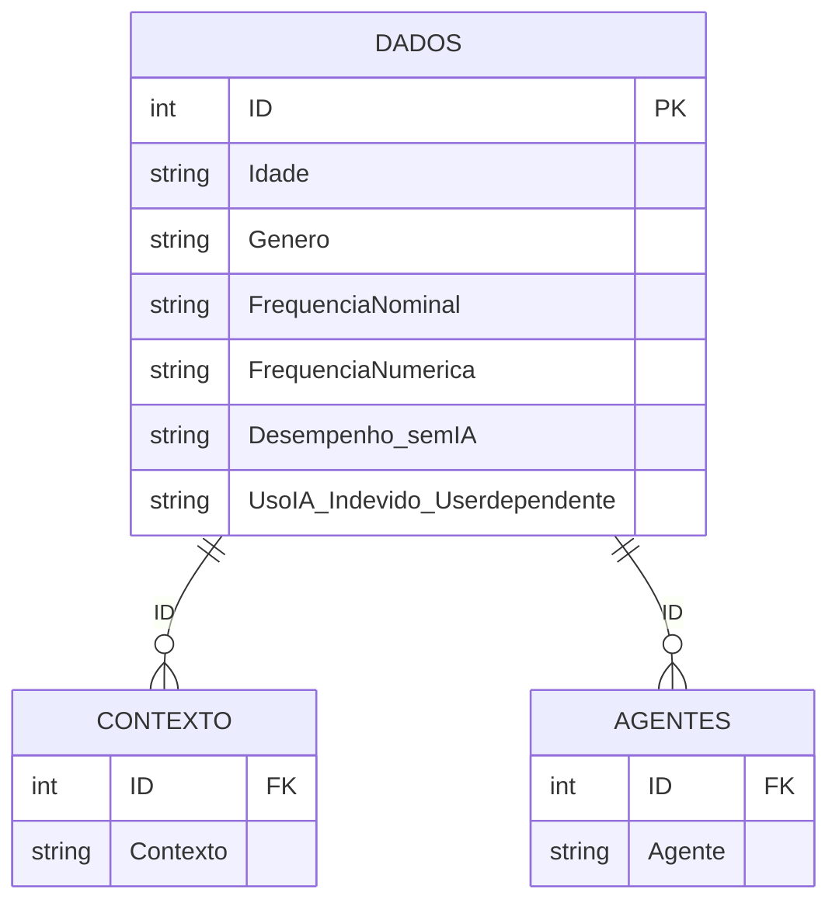

# 📊 Usabilidade e Interação com I.A — Dashboard em Power BI

Projeto de conclusão do curso de **Power BI** que analisa como as pessoas usam ferramentas de Inteligência Artificial no dia a dia: quais agentes utilizam, em quais contextos, com que frequência e qual a percepção sobre dependência da tecnologia.

Fomos honrados em ser escolhidos pelos professores para apresentar o nosso trabalho durante a formatura, evidenciando o destaque e dedicação do grupo.

A base é uma **pesquisa própria com 84 respondentes**, coletada em abril de 2026. Os dados brutos passaram por um processo de tratamento e modelagem no **Power Query** antes de alimentar o dashboard.


-217346?style=for-the-badge&logo=microsoftexcel&logoColor=white)


---

## 📑 Sumário

- [Objetivo](#-objetivo)
- [A pesquisa](#-a-pesquisa)
- [Estrutura do repositório](#-estrutura-do-repositório)
- [Tratamento de dados](#-tratamento-de-dados)
- [Modelo de dados](#-modelo-de-dados)
- [Dashboard](#-dashboard)
- [Principais números](#-principais-números)
- [Como executar](#-como-executar)
- [Privacidade dos dados](#-privacidade-dos-dados)
- [Melhorias futuras](#-melhorias-futuras)
- [Equipe](#-equipe)

---

## 🎯 Objetivo

Transformar as respostas de um questionário em informação visual e interativa, permitindo explorar o perfil de uso de I.A por **faixa etária**, **gênero**, **contexto de uso** e **agente utilizado**, além de entender a percepção dos usuários sobre autonomia e dependência.

## 📝 A pesquisa

O questionário reuniu **84 respostas** e foi estruturado com as seguintes perguntas:

| Pergunta | Tipo de resposta |
|---|---|
| Qual a sua idade? | Única (faixas etárias) |
| Qual seu gênero? | Única |
| Em qual contexto você mais utiliza a I.A? | **Múltipla escolha** |
| Qual a sua frequência de uso de I.A na semana? | Única (escala: Nunca → Sempre) |
| Qual agente de I.A você costuma usar? | **Múltipla escolha** |
| Você acredita que conseguiria desempenhar suas atividades sem o uso de I.A? | Sim / Não |
| Você acredita que o uso indevido da I.A torna o usuário dependente de seu uso? | Sim / Não / Talvez |

> As perguntas de **múltipla escolha** chegam do formulário em uma única célula, com os valores separados por `;` (ex.: `Conversa;Consulta de informação;`). Esse formato foi o principal desafio do tratamento — veja a seção abaixo.

## 📁 Estrutura do repositório

```
TrabalhoBI/
├── Pesquisa - Usabilidade e interação com I.A (1-84).xlsx   # Base bruta (respostas do formulário)
├── TrabalhoBIv2.pbix                                        # ✅ Versão final do relatório
└── TrabalhoBI DESUSO.pbix                                   # Versão anterior (mantida como histórico)
```

---

## 🧹 Tratamento de dados

Toda a preparação foi feita no **Power Query (linguagem M)**, partindo da planilha exportada do formulário. As etapas aplicadas na tabela principal (`DADOS`) foram:

1. **Importação** da planilha Excel e promoção da primeira linha a cabeçalho.
2. **Tipagem das colunas** (`ID` como inteiro, datas como `datetime`, demais como texto).
3. **Remoção de colunas sem valor analítico ou sensíveis**: `Start time`, `Completion time`, `Email`, `Name` e `Last modified time`.
4. **Renomeação das colunas**: os enunciados completos das perguntas viraram nomes curtos e amigáveis ao modelo.

   | Original | Renomeada |
   |---|---|
   | Qual a sua idade? | `Idade` |
   | Qual seu Gênero? | `Genero` |
   | Em qual contexto você mais utiliza a I.A? | `Contexto` |
   | Qual a sua frequência do uso de I.A na semana? | `FrequenciaNominal` |
   | Qual agente de I.A você costuma usar? | `Agente` |
   | Você acredita que conseguiria desempenhar as suas atividades sem o uso do I.A? | `Desempenho_semIA` |
   | Você acredita que o uso indevido da I.A torna o usuário dependente de seu uso? | `UsoIA_Indevido_Userdependente` |

5. **Criação da coluna `FrequenciaNumerica`**: conversão da escala textual em escala numérica ordinal, possibilitando ordenar e agregar a frequência de uso.

   | FrequenciaNominal | FrequenciaNumerica |
   |---|---|
   | Nunca | 0 |
   | Raramente | 1 |
   | As vezes | 2 |
   | Frequentemente | 3 |
   | Sempre | 4 |

6. **Separação das colunas de múltipla escolha em tabelas próprias** (`CONTEXTO` e `AGENTES`): cada uma é derivada da base original, mantém apenas `ID` + a coluna de interesse, **divide o texto pelo delimitador `;`**, expande cada valor em uma linha própria e **filtra as linhas vazias** geradas pelo `;` final.

### 🔄 Da versão 1 para a versão 2

A primeira versão (`TrabalhoBI DESUSO.pbix`) usava **uma única tabela** em que as duas colunas de múltipla escolha (`Contexto` e `Agentes`) eram expandidas ao mesmo tempo. Isso fazia com que cada respondente fosse **replicado em várias linhas** (uma para cada combinação de contexto × agente), o que distorce contagens e médias.

Na versão final (`TrabalhoBIv2.pbix`) o problema foi resolvido com **normalização**: `Contexto` e `Agente` saíram da tabela principal e passaram a ser tabelas separadas, ligadas por `ID`. Assim, a tabela `DADOS` tem **exatamente uma linha por respondente** e as contagens ficam consistentes.

| | v1 (`DESUSO`) | v2 (final) |
|---|---|---|
| Estrutura | 1 tabela achatada | 3 tabelas relacionadas |
| Linhas por respondente | Múltiplas (explosão de combinações) | 1 em `DADOS` |
| Multi-valor | Dividido na mesma tabela | Tabelas `CONTEXTO` e `AGENTES` |
| Contagem de respondentes | Sujeita a inflação | Confiável |

---

## 🗂️ Modelo de dados

O modelo final segue um esquema em estrela simplificado, com `DADOS` no centro e duas tabelas de apoio relacionadas pela coluna `ID`.



- **Relacionamentos:** `CONTEXTO[ID] → DADOS[ID]` e `AGENTES[ID] → DADOS[ID]`, ambos *muitos-para-um*, com filtro cruzado em ambas as direções.
- Um respondente pode ter várias linhas em `CONTEXTO` e `AGENTES`, mas apenas uma em `DADOS`.

### Dicionário de dados

**DADOS**

| Coluna | Descrição | Valores |
|---|---|---|
| `ID` | Identificador do respondente | 1 a 84 |
| `Idade` | Faixa etária | 16 - 20 · 21 - 25 · 26 - 30 · Mais de 30 anos |
| `Genero` | Gênero informado | Masculino · Feminino · Outro |
| `FrequenciaNominal` | Frequência semanal de uso | Nunca · Raramente · As vezes · Frequentemente · Sempre |
| `FrequenciaNumerica` | Frequência em escala numérica | 0 a 4 |
| `Desempenho_semIA` | Acredita que conseguiria trabalhar/estudar sem I.A? | Sim · Não |
| `UsoIA_Indevido_Userdependente` | Acredita que uso indevido gera dependência? | Sim · Não · Talvez |

**CONTEXTO** — `Contexto`: Trabalhos Acadêmicos · Consulta de informação · Programação e geração de código · Geração de mídias · Conversa · Não Uso I.A

**AGENTES** — `Agente`: ChatGPT · Gemini · Copilot · Claude Code · Grok · Outros

---

## 📈 Dashboard

A página **Dash** reúne os principais indicadores da pesquisa:

| Visual | O que mostra |
|---|---|
| Cartão | Total de respondentes |
| Cartão | Faixa etária mínima da amostra |
| Gráfico de barras | Agentes de I.A mais utilizados |
| Gráfico de colunas | Contextos de uso |
| Gráfico de colunas | Frequência de uso por faixa etária |
| Gráfico de colunas | Frequência de uso por gênero |
| Gráfico de pizza | Percepção de conseguir atuar sem I.A |
| Segmentação (slicer) | Filtro por **Idade** |
| Segmentação (slicer) | Filtro por **Agente** |

Todos os visuais respondem aos filtros, o que permite, por exemplo, ver o perfil de contextos de uso apenas dos usuários de determinado agente ou de uma faixa etária específica.

---

## 🔎 Principais números

*Percentuais calculados sobre os 84 respondentes. Nas perguntas de múltipla escolha, os valores não somam 100%.*

- **Perfil:** 61% têm entre 16 e 20 anos; 51% se identificam como masculino, 44% como feminino e 5% como outro.
- **Frequência:** 69% usam I.A "Frequentemente" ou "As vezes"; 10% usam "Sempre".
- **Agentes:** ChatGPT é o mais usado (64%), seguido de Gemini (42%) e Copilot (15%).
- **Contextos:** Trabalhos acadêmicos (65%) e consulta de informação (60%) lideram; programação aparece em 32%.
- **Autonomia:** 86% acreditam que conseguiriam desempenhar suas atividades sem I.A.
- **Dependência:** 79% acreditam que o uso indevido torna o usuário dependente; 14% responderam "Talvez".

---

## ▶️ Como executar

**Pré-requisito:** [Power BI Desktop](https://powerbi.microsoft.com/desktop/) instalado.

1. Clone ou baixe este repositório.
2. Abra o arquivo `TrabalhoBIv2.pbix` no Power BI Desktop.
3. **Atualize o caminho da fonte de dados** — o relatório foi construído apontando para um caminho local:
   - Vá em **Transformar dados → Configurações da fonte de dados**.
   - Altere o caminho para o local onde você salvou a planilha `Pesquisa - Usabilidade e interação com I.A (1-84).xlsx`.
4. Clique em **Atualizar** para recarregar os dados.

> 💡 Sem esse ajuste, o Power BI exibirá erro de arquivo não encontrado ao atualizar, pois o caminho original pertence à máquina em que o projeto foi desenvolvido.

## 🔒 Privacidade dos dados

Durante o tratamento, as colunas de identificação (`Email`, `Name`) e os registros de data/hora das respostas foram **removidos do modelo**. O relatório trabalha apenas com respostas anônimas e agregadas.

## 🚀 Melhorias futuras

- Converter `FrequenciaNumerica` para tipo numérico e criar medidas DAX (ex.: **média de frequência** por grupo), em vez de contagem.
- Criar uma tabela de ordenação para `Idade`, evitando depender da ordem alfabética das faixas.
- Preencher as páginas **Menu** e **Info** com navegação e a descrição da pesquisa.
- Tornar a fonte de dados independente de caminho local (parâmetro no Power Query ou pasta do SharePoint/OneDrive).
- Ampliar a amostra e incluir novas perguntas (ex.: finalidade profissional vs. pessoal).

## 👥 Equipe

| Integrante | Responsabilidade |
|---|---|
| **[Bruno Wai Lu]** | **Tratamento e modelagem de dados (Power Query)** |
| [Maria Eduarda Aguiar] | [Ex.: Desenvolvimento do design do dashboard] |
| [Kaylane Nascimento] | [Ex.: Elaboração e aplicação da pesquisa] |

---

<p align="center">
  Projeto de conclusão do curso de Power BI · [Nome da instituição/curso] · 2026
</p>
